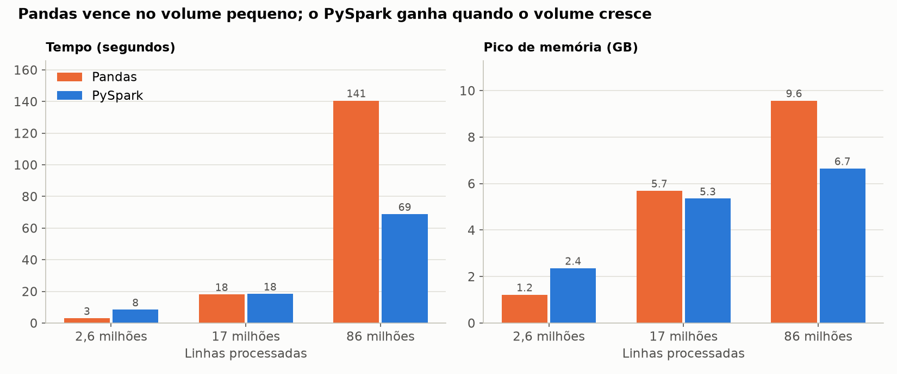
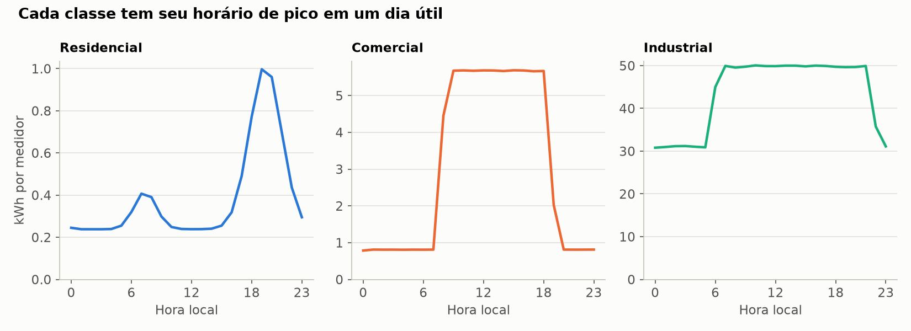
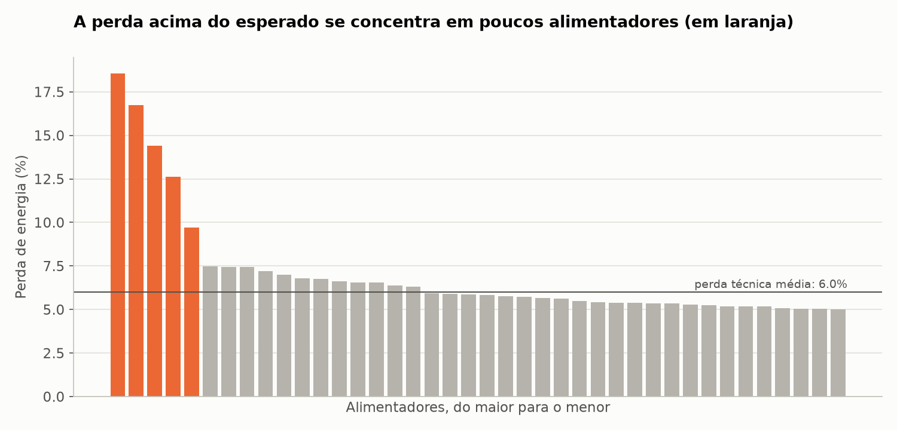
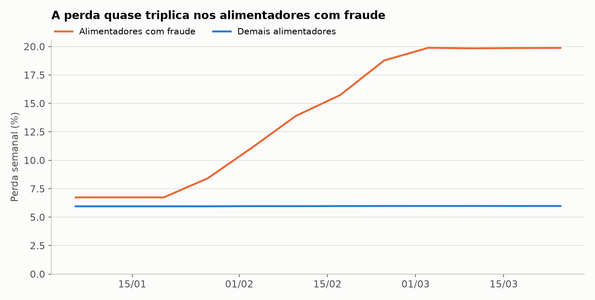

# 09 · Big Data com PySpark e Databricks

Lakehouse de medidores inteligentes com PySpark e Delta Lake, em arquitetura medalhão. Processa 17
milhões de leituras em lotes incrementais, encontra fraudes e interrupções e compara o mesmo pipeline
em Pandas e PySpark em até 86 milhões de linhas.

## Problema e contexto

A **Vale Claro Energia** (empresa fictícia) recebe uma leitura de cada medidor a cada 15 minutos. Com
2.000 medidores, são quase 200 mil linhas por dia. O dado chega com retransmissões, atrasos e dois
firmwares diferentes, e o medidor não informa o consumo: informa um registrador acumulado.

O objetivo é transformar essa telemetria em energia confiável por cliente e por alimentador, medir as
perdas, encontrar fraudes, calcular indicadores de interrupção e saber quando Spark realmente compensa.

## Origem dos dados

Os dados são sintéticos e gerados por `scripts/generate_data.py`, em quatro escalas. Ficam fora do
repositório, porque a escala grande ocupa 718 MB comprimidos. O gabarito guarda a verdade antes da sujeira.

| Escala | Medidores | Dias | Leituras |
|---|---:|---:|---:|
| mini | 60 | 21 | 120 mil |
| pequena | 300 | 90 | 2,6 milhões |
| media | 2.000 | 90 | 17 milhões |
| grande | 10.000 | 90 | 86 milhões |

| Fonte | Formato |
|---|---|
| Telemetria dos medidores | CSV comprimido por dia de chegada |
| SCADA dos alimentadores | CSV diário, com energia injetada e horário local |
| Cadastro e trocas de medidor | CSV |

## Problemas encontrados e tratamento

Números da escala media:

| Problema | Tratamento |
|---|---|
| Firmware v1 envia epoch e Wh; v2 envia ISO com fuso e kWh | `normalizar` unifica os dois |
| Medidores com relógio atrasado em até 40 segundos | horário alinhado aos 15 minutos mais próximos |
| 516.309 retransmissões | `dropDuplicates` no lote e `MERGE` entre lotes |
| 345.367 leituras atrasadas em até 3 dias | `MERGE` na partição certa e recálculo a partir do dia mais antigo |
| 7.216 leituras perdidas por falha de comunicação | o registrador continua, então a energia aparece na leitura seguinte |
| 2.634 picos, valores corrompidos no registrador | regra de monotonicidade e limite físico de salto |
| 16 viradas do registrador em 100.000 | soma o que faltava para o limite |
| 10 trocas de medidor | soma o fim do registrador antigo e o início do novo |
| Clientes industriais com transformador de corrente | a diferença é multiplicada pelo fator do cadastro |
| 361 linhas malformadas | quarentena, sem derrubar o job |
| Dia do fechamento | a leitura de 00:00 pertence ao dia anterior, no fuso de Brasília |

## Arquitetura

```text
landing ──▶ BRONZE ──────────▶ SILVER ──────────────────▶ GOLD ─────────▶ relatório
            como chegou        leituras limpas (MERGE)     consumo diário
            texto, append      intervalos de energia       balanço de energia
            Structured         quarentena                  interrupções
            Streaming          (constraint CHECK)          suspeitas de fraude
```

| Camada | Tabelas | Escrita |
|---|---|---|
| Bronze | leituras, scada | streaming com `availableNow` e checkpoint |
| Silver | leituras, intervalos, quarentena, cadastro | `MERGE` e `replaceWhere` por partição |
| Gold | consumo diário, balanço, perfil horário, interrupções, suspeitas, faturamento | reconstrução |

```text
09-pyspark-databricks/
├── databricks.yml        job do Databricks como código
├── notebooks/            ponto de entrada no Databricks
├── scripts/              gerador de dados
├── src/
│   ├── transformacoes/   regras como funções puras de DataFrame
│   ├── camadas/          bronze, silver, gold e manutenção
│   ├── pandas_pipeline.py
│   └── benchmark.py, chegada.py, quality.py, report.py, visualize.py
├── tests/
└── main.py
```

## Decisões de engenharia

- **Regras separadas de leitura e escrita.** `src/transformacoes` só recebe e devolve DataFrames.
  Isso permite testar com cinco linhas e usar o mesmo código localmente e no Databricks.
- **Sem UDF em Python.** Tudo usa funções nativas, que o Spark otimiza. Uma UDF forçaria cada linha a
  passar pelo Python.
- **Streaming sem servidor ligado.** O trigger `availableNow` processa o que há de novo e para. O
  checkpoint garante que cada arquivo entre uma vez, mesmo com o job rodando de novo.
- **Conversões seguras.** O Spark 4 usa modo ANSI, em que um cast inválido derruba o job. Com
  `try_cast`, o valor vira nulo e vai para a quarentena.
- **Poda de partição no MERGE.** A condição inclui o intervalo de datas do lote; sem isso, a tabela
  inteira seria reescrita.
- **Pendências gravadas.** A menor data afetada fica em uma tabela Delta e só é apagada depois do
  recálculo. Se o passo falhar, a próxima execução retoma de onde parou.
- **Recálculo com âncora.** Os intervalos usam a última leitura válida antes do trecho, então a conta
  atravessa lotes diferentes.
- **Broadcast nas dimensões.** Cadastro e trocas são pequenos e vão inteiros para cada tarefa, sem
  embaralhar os 17 milhões de leituras.

### O que os dados maiores revelaram

Na escala pequena, tudo bateu. Na media, a energia residencial ficou 3% acima do gabarito, por dois
casos raros demais para aparecer antes: dois picos seguidos e um pico na primeira leitura de um lote,
que não tinha valor anterior para comparar. A correção usa duas passadas e a âncora, e os dois casos
viraram testes.

## Pandas ou PySpark?

Mesmo trabalho nos dois: ler os arquivos brutos, limpar, calcular os intervalos e consolidar o consumo
diário. Cada motor rodou em um processo separado, em um MacBook com 10 núcleos e 16 GB.



| Linhas | Pandas | PySpark | Memória no Pandas | Memória no PySpark |
|---:|---:|---:|---:|---:|
| 2,6 milhões | 3 s | 8 s | 1,2 GB | 2,4 GB |
| 17 milhões | 18 s | 18 s | 5,7 GB | 5,3 GB |
| 86 milhões | 141 s | 69 s | 9,6 GB | 6,7 GB |

- **Até alguns milhões de linhas, o Pandas é a escolha certa.** O Spark gasta segundos só para iniciar.
- **O empate fica perto de 17 milhões de linhas** nesta máquina e neste pipeline.
- **Esperava que o Pandas falhasse em 86 milhões, e ele não falhou.** Concluiu com o mesmo resultado
  do Spark: as mesmas 900.000 linhas e os mesmos 37.272.347,794 kWh.
- **A diferença real é o limite.** O Pandas precisa de tudo na memória, e o macOS comprime páginas, então
  o pico medido pode estar abaixo do uso real. O Spark trabalha em partes, tem a memória limitada a 6 GB
  e pode continuar crescendo com mais máquinas.

Um único computador é o melhor caso para o Pandas. Em um cluster, a vantagem do Spark tende a aumentar.

## Databricks

O projeto traz o job como código em `databricks.yml`, com as tarefas bronze, silver, gold e manutenção,
e o notebook `notebooks/pipeline.py`. Os pontos que costumam quebrar no serverless já foram considerados:
não usa `cache`, e o `foreachBatch` usa a sessão do próprio lote.

**Essa parte ainda não foi executada no Databricks**, porque depende de um workspace. O que foi verificado
é a execução local do mesmo código; o bundle não passou por `databricks bundle validate`. Com uma conta
na edição gratuita, os passos são: criar um Volume, enviar a pasta `raw`, e rodar:

```bash
databricks bundle deploy -t dev
```

```bash
databricks bundle run medalhao -t dev
```

## Tecnologias

PySpark 4.2, Delta Lake 4, Structured Streaming, Python 3.14, Java 21, Pandas 3, Matplotlib e pytest.

## Como executar

É preciso ter Java 17 ou 21. Na primeira execução, o Spark baixa os JARs do Delta.

```bash
python3.14 -m venv .venv
```

```bash
source .venv/bin/activate
```

```bash
pip install -r requirements.txt
```

```bash
python scripts/generate_data.py --escala pequena
```

```bash
python main.py --escala pequena
```

```bash
pytest
```

Para reproduzir os resultados abaixo, gere a escala `media` e use `python main.py --escala media --recriar`.
A comparação de motores precisa das escalas geradas e roda com `python -m src.benchmark --escalas pequena media grande`.

## Resultados obtidos

Escala media, em três lotes, com pouco mais de 2 minutos de execução.

| Indicador | Valor |
|---|---|
| Linhas na bronze | 17.751.765 |
| Leituras na silver | 17.235.095 |
| Energia medida | 7.273.881 kWh |
| Energia injetada | 7.792.921 kWh |
| Perda geral | 6,7% |
| Receita estimada | R$ 5,13 milhões |
| Interrupções | 80 |
| DEC e FEC do trimestre | 4,71 horas e 2,00 interrupções por cliente |

### Perfil de consumo



Residências têm o pico no início da noite, enquanto comércio e indústria acompanham o horário de
operação. Só entram intervalos regulares: a diferença acumulada depois de um buraco distorceria a hora.

### Perdas e fraudes



Cinco dos 40 alimentadores têm perda de 13,6% no período, contra 6,0% nos demais, que é o patamar da
perda técnica.



A perda nesses alimentadores vai de 6,7% para quase 20%, conforme as fraudes começam. A detecção compara
cada medidor com ele mesmo, depois de dividir pela mediana da classe no dia, o que retira clima e fim de
semana. Foram 69 suspeitos, e os 69 eram as fraudes do gabarito.

Esse acerto de 100% é otimista, porque a fraude simulada é uma queda limpa de 70%. Em dados reais, mudança
de moradores ou de negócio gera falsos positivos, e a lista serve para priorizar a inspeção.

### Qualidade

As 9 verificações críticas e os 2 alertas passaram. O lakehouse bate com o gabarito em leituras, picos,
linhas malformadas e trocas. A energia por classe tem erro relativo de 2e-08, que é arredondamento do
registrador. As 80 interrupções do gabarito foram encontradas, com o alimentador, o dia e a duração corretos.

Os 26 testes incluem a igualdade entre Pandas e PySpark no consumo de cada medidor e dia, a reexecução sem
efeito, time travel e a recusa de dado inválido pela constraint do Delta.

### Compactação

`OPTIMIZE` com `ZORDER` levou a silver de 96 para 90 arquivos, e a consulta de um medidor continuou em
torno de 0,2 s, com variação entre execuções maior que qualquer ganho. A tabela já tem cerca de um arquivo
por dia. Esses comandos fazem diferença com muitas cargas pequenas, o que não acontece em três lotes.

## Limitações

- **Spark local.** Tudo rodou em uma máquina, sem rede entre nós, que é o principal custo de um cluster.
- **Gold reconstruída.** Cabe nesta escala; com mais histórico, seria melhor recalcular só as partições afetadas.
- **Energia concentrada depois de buracos.** A soma do dia fica certa, mas a curva daquele intervalo não.
- **Perfil horário.** Cada intervalo entra na hora em que termina, o que desloca a curva em até 15 minutos.
